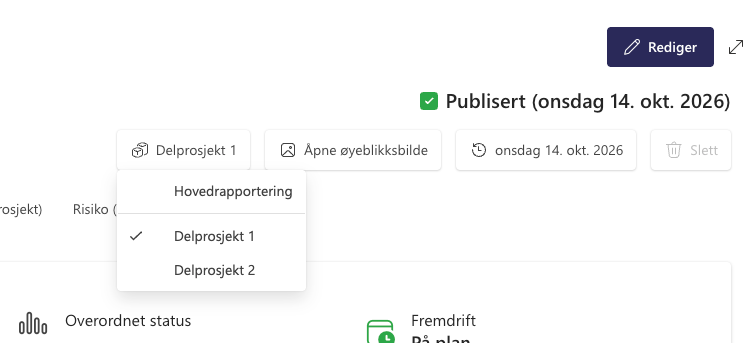
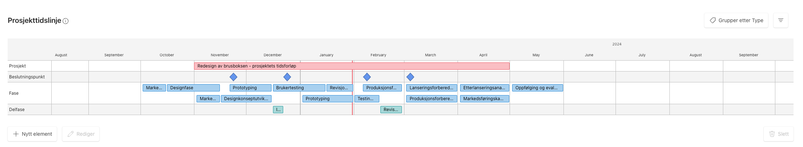
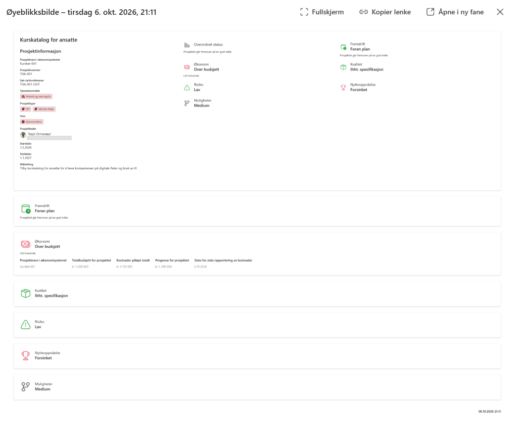

# Prosjektportalen 365 - 1.15.0 (TBA)

**Versjon 1.15.0** adresserer følgende [issues](https://github.com/Puzzlepart/prosjektportalen365/issues?q=is%3Aissue+is%3Aclosed+milestone%3A1.15.0).
> **Nedlasting**: [v1.15.0](https://github.com/Puzzlepart/prosjektportalen365/releases)

---

Velkommen til versjon 1.15.0 av Prosjektportalen 365. I denne versjonen kan prosjekter rapportere status i flere parallelle serier med multirapportering, og program og overordnede prosjekter får risiko- og mulighetsmatriser som aggregerer usikkerhetselementer fra underprosjektene. Her er høydepunktene i denne utgivelsen:

- **[Multirapportering av prosjektstatus](#multirapportering-av-prosjektstatus)** - Flere parallelle rapporteringsserier («delprosjekter») per prosjekt, med egen velger på statussiden og én rad per serie i porteføljeoversikten.
- **[Matriser for program og overordnede prosjekter](#matriser-for-program-og-overordnede-prosjekter)** - Risiko- og mulighetsmatrisene kan nå aggregere usikkerhetselementer fra underprosjekter, automatisk og uten konfigurasjon.
- **[Modernisert teknisk grunnmur](#modernisert-teknisk-grunnmur)** - Ny byggekjede (SPFx 1.24, Node 26), PnPjs 4, Fluent UI v9 i webdelene og automatiske tester i hvert bygg og mot testmiljøet. Ingen tilsiktet funksjonell endring, men et solid fundament for videre utvikling.
- **[Universell utforming](#universell-utforming)** - Webdelene og utvidelsene er gjennomgått mot kravene i WCAG 2.1 AA og kan brukes med tastatur og skjermleser: alt har navn, fokus blir der du er, og farger og status leses tydelig.

## Multirapportering av prosjektstatus

Enkelte prosjekter er i praksis flere prosjekter i ett - for eksempel delprosjekter med hver sin fremdrift og hvert sitt risikobilde. Til nå har `Prosjektstatus` kun støttet én rapporteringsserie per prosjektområde. Med multirapportering kan et prosjekt vedlikeholde flere parallelle rapporteringsserier i tillegg til hovedrapporteringen.

**Slik fungerer det:**

- Funksjonen aktiveres per prosjekt i egenskapene til `Prosjektstatus`-webdelen, i den nye gruppen `Multirapportering`. Der defineres delprosjektene med én linje per serie på formatet `nøkkel|visningsnavn` (f.eks. `DP1|Delprosjekt 1`)
- Når multirapportering er aktivert vises en delprosjekt-velger i verktøylinjen på statussiden. Nye statusrapporter opprettes i valgt serie, og serienavnet inngår i rapporttittelen
- `Prosjektstatus.aspx?scope=<nøkkel>` gir dyplenker direkte til en bestemt serie, for eksempel fra delprosjektets egne sider

**Ingen nye felter - trygt for eksisterende data:**

Serietilhørigheten lagres som et suffiks på den eksisterende `GtSiteId`-verdien i hubens `Prosjektstatus`-liste (`<områdeid>-DP1`). Det betyr ingen nye kolonner, ingen endringer i søkeskjemaet og ingen oppgraderingssteg - alle eksisterende rapporter utgjør automatisk hovedrapporteringen, som oppfører seg nøyaktig som før. Prosjekter som ikke tar i bruk funksjonen er helt uberørt.

**I portefølje og program:**

Porteføljeoversikten og programvisningene viser én rad per rapportserie, navngitt «Prosjektnavn – nøkkel», med riktig statusrapport-kolonne per serie. Prosjekttidslinjen viser hovedserien. `Prosjektinformasjon`-webdelen grupperer statusrapport-lenkene per serie, med hovedserien først.

**Dynamiske statusseksjoner per delprosjekt:**

Statusseksjoner kan bruke tokenene `{scope}` og `{scopeLabel}` i feltene `GtSecList`, `GtSecViewQuery` og `GtSecView` i `Statusseksjoner`-listen. Dermed kan for eksempel usikkerhets- og leveranseseksjonene peke på egne lister per delprosjekt (`Usikkerhet {scope}`). Seksjoner som bruker tokens vises kun for delprosjekt-serier, ikke for hovedrapporteringen.

**Ekskluderte seksjoner:**

I tillegg har `Prosjektstatus`-webdelen fått egenskapen `Ekskluderte seksjoner` - én seksjonstittel per linje (matcher `Tittel` i `Statusseksjoner`-listen) for å skjule seksjoner fra statussiden, fanene og sammendraget på enkeltprosjekter, uten å endre hub-konfigurasjonen.

## Matriser for program og overordnede prosjekter

Program og overordnede prosjekter har til nå kun kunnet vise underprosjektenes usikkerheter som en liste via den aggregerte oversikten. Nå kan `Risikomatrise`- og `Mulighetsmatrise`-webdelene aggregere usikkerhetselementer fra underprosjektene og vise dem i selve matrisen.

**Automatisk og uten konfigurasjon:**

Webdelene har fått en ny egenskap, `Datainnhenting`, med valgene `Automatisk` (standard), `Lokal liste` og `Datakilde`. I automatisk modus oppdager webdelen selv at den står på et program- eller overordnet område med tilgjengelig hub, og bytter til aggregering via søk. På vanlige prosjekter brukes den lokale usikkerhetslisten som før, så eksisterende matriser er uberørt.

**Verdt å vite:**

- **Underprosjektene styrer hva som vises**: Som standard vises underprosjektenes elementer bare når de er merket med `Vis i porteføljen`, mens programmets eller det overordnede prosjektets egne elementer alltid vises, som før. Filteret kan slås av i egenskapsruten for paritet med den aggregerte listevisningen
- **Tydelig opphav**: Elementene merkes med de to første bokstavene i områdets navn og elementets ID (f.eks. `BY12` for element 12 i «Bymiljø»), og tooltip viser områdenavn og tittel
- **Robust mot språkforskjeller**: Standard datakildene («Alle risikoelementer for underområder» og tilsvarende for muligheter) løses via datakilde-ID (GUID), slik at oppslaget virker uavhengig av installasjonsspråk og brukerens språkinnstilling
- **Vis tittel**: Begge matrisewebdelene har fått en valgfri tittel (av som standard), nyttig for å skille matrisene når risiko og muligheter står på samme side

## Modernisert teknisk grunnmur

Denne versjonen bærer den største tekniske oppgraderingen Prosjektportalen har fått. Den er ikke synlig i grensesnittet, og det er nettopp poenget: alt skal se ut og oppføre seg som før.

- **Ny byggekjede.** Alle løsningene bygges nå med SharePoint Framework 1.24 på Microsofts nye Heft-verktøykjede, Node 26 og TypeScript 5.8. Den gamle gulp-baserte kjeden og Node 16 er faset ut. Dette holder Prosjektportalen på en støttet plattform.
- **PnPjs 4.** Databiblioteket som alle webdelene bruker mot SharePoint er løftet fra versjon 3 til 4. Underveis er to eksterne pakker som ikke lenger vedlikeholdes tatt inn i vår egen kode, og provisjoneringsmotoren `sp-js-provisioning` er oppgradert til 1.4.0.
- **Fluent UI v9.** Grensesnittbiblioteket er løftet fra Fluent UI v8 til v9 i alle webdelene og utvidelsene: paneler, dialoger, menyer, skjemakontroller, personvelgeren og alle listene, også hovedlisten i porteføljeoversikten og den aggregerte oversikten. Alt skal se ut og oppføre seg som før. Noen små forskjeller er gjort med vilje: i hovedlisten velger du rader med avkrysningsboksen eller et klikk på raden, et område med Shift+klikk, en gruppe med gruppens avkrysningsboks og alle med boksen over kolonnene, mens utvalg ved å dra med musen over radene er fjernet; personvelgeren viser de valgte personene som merkelapper; statusrapporten rulles med resten av siden i stedet for i en egen rullboks, med fanene festet øverst; og i «Hent dokumentmal» velger du målmappe ved å merke raden og angrer ved å merke den en gang til, mens mappenavnet fortsatt åpner mappen.
- **React 18 og oppdaterte biblioteker.** Webdelene og utvidelsene kjører på React 18, som SharePoint leverer til dem, i stedet for React 17. Redux Toolkit er løftet fra 1.5 til 2.13, og SheetJS, som lager Excel-filene, fra 0.16 til 0.20.3, som lukker kjente sikkerhetshull. Dra-og-slipp i «Vis eller skjul kolonner» bruker den vedlikeholdte `@hello-pangea/dnd` i stedet for `react-beautiful-dnd`, og fire ubrukte pakker fra React 15/16-tiden er fjernet. Avhengigheter med kjente sårbarheter er løftet eller fjernet: lodash og moment er oppdatert, og `xmldom` er byttet med nettleserens egen XML-tolker. De gjenværende funnene ligger i verktøy som bare brukes ved bygging, og i deler av PnP-kontrollene som Prosjektportalen ikke tar i bruk.
- **Én regel for termetiketter.** Fasenavn, dokumenttyper og andre termer vises nå etter samme regel overalt: områdets språk først, deretter norsk (`nb-NO`), deretter engelsk (`en-US`). Norske områder ser ingen forskjell; engelske områder får engelske etiketter der de finnes.
- **Automatiske tester.** Hver webdel, utvidelse og interaktiv komponent har nå tester, og over 1 000 enhets- og komponenttester kjører i hvert bygg. Etter hver utrulling til testmiljøet åpner over 70 Playwright-tester huben, et prosjektområde og et programområde, går gjennom navigasjonen og prøver flyter som skriver til SharePoint og rydder etter seg (et utkast til statusrapport, en kopi av en dokumentmal, en ny kolonne i porteføljeoversikten, et underområde i et program), og sjekker at webdelene faktisk laster og ikke bryter kravene til universell utforming. I tillegg kjører rundt 50 integrasjonstester datalaget direkte mot testmiljøet, uten nettleser: søk, termlageret, prosjektegenskaper, synkroniseringen til huben, statusrapporter, kolonner i porteføljevisningene og resultatet av oppgraderingen. De sjekker hva SharePoint faktisk lagrer og returnerer, og fant fire feil som er rettet i denne versjonen. Testene fant og stoppet en rekke feil før de nådde noen kunde; de er listet i endringsloggen. Den manuelle smoke-testen beholdes for flytene som ennå ikke er automatisert.

**Hva betyr det for deg?** Ingenting ved installasjon eller oppgradering med utgivelsespakken endres; krav til PnP.PowerShell er som før. Bygger du Prosjektportalen selv fra kildekoden, trenger du Node 26 (`.nvmrc` i repoet angir versjonen). Meld gjerne fra om noe ser eller oppfører seg annerledes enn i 1.14 — det er per definisjon en feil i denne versjonen.

## Universell utforming

Prosjektportalen er gjennomgått komponent for komponent mot kravene til universell utforming. Målet er WCAG 2.1 nivå A og AA, som forskriften om universell utforming av IKT krever gjennom standarden EN 301 549, og i tillegg fire kriterier fra WCAG 2.2. Webdelene og utvidelsene kan nå brukes med tastatur og skjermleser på en helt annen måte enn før.

**Hva er bedre:**

- **Tastatur**: Alt kan nås og brukes uten mus, også elementene i tidslinjene og matrisene, kolonnene i porteføljeoversikten (som nå også kan flyttes med tastaturet), hurtigmenyen på prosjektkortene og bunnteksten. Når et panel, en dialog eller en meny lukkes, står fokus der du var, i stedet for øverst på siden.
- **Skjermleser**: Knapper, felt og dialoger har norske navn. Lister, tabeller, navn og verdier og overskrifter leses som det de er. Søk, antall treff, opplasting, synkronisering og fremdrift i oppsett og installasjon leses opp.
- **Kontrast og farge**: Tekst og figurer skiller seg nok fra bakgrunnen, også med farger fra konfigurasjonen, som tidslinjens. Status vises med tekst eller med et merke formet som en hake, et varseltegn eller et kryss, ikke bare med farge.
- **Lenker**: Det som åpner en side, er en lenke, så den kan åpnes i ny fane.

**Synlige endringer:**

- Søylene i tidslinjene vises i en lys tone av fargen sin, med kant i fargen og svart tekst, og milepælene har en kant i en mørkere tone av sin egen farge. Fargene i tidslinjekonfigurasjonen er de samme som før.
- I fasevelgeren er gjeldende fase mørk med hvit tekst, og de andre fasene er lyse med svart tekst.
- Statusikonene i statuskolonnen, på statussiden og med «Vis kun ikoner» har et lite merke ved siden av, som viser statusen med form: en hake, et varseltegn eller et kryss. Merket følger fargen statusverdien har i `Prosjektkolonnekonfigurasjon`. En verdi kan også få sitt eget ikon der, og da er det ikonet som vises som merke.
- Dagens dato i tidslinjene har etiketten «I dag». Når verktøylinjene smalner, er det søkefeltet som gir etter, og på en mobilskjerm går knappene til neste linje i stedet for utenfor webdelen.
- Mindre endringer: trendikonene i gull og grønt har en kant, hjelpedialogen i bunnteksten har tittel og lukkeknapp, og assistentens innstillinger vises bare for administratorer.

**Verdt å vite:** Gjennomgangen gjelder det Prosjektportalen selv viser. SharePoints egne sider, listevisninger og egenskapsruten er Microsofts ansvar, og innholdet redaktørene skriver, må de selv utforme. Meld gjerne fra om noe er vanskelig å bruke med tastatur eller skjermleser.

**Tilgjengelighetsoversikt:** Status per WCAG-kriterium, med de kjente avvikene, står i [Tilgjengelighet per WCAG-kriterium](../.development-guide/spfx/tilgjengelighet-wcag.md). Den kan brukes i egne vurderinger og anskaffelser.

## Andre forbedringer verdt å nevne

I tillegg til høydepunktene over er det gjort flere forbedringer og feilrettinger:

- **Personfelter på statusrapporter**: Rettet en feil hvor person-/brukerfelter på statusrapporter ble lagret med bruker-ID fra prosjektområdet i stedet for hubområdet, slik at feil person kunne vises i porteføljen. Redigeringspanelet binder nå person-, taksonomi- og oppslagsfelt mot hublisten, og «Bruk verdier fra forrige rapport» tar med person- og flerpersonfelter korrekt
- **Øyeblikksbilde av statusrapporten**: `Åpne øyeblikksbilde` i `Prosjektstatus` viser øyeblikksbildet i et vindu som fyller nettleseren, i full bredde med rulling i stedet for zoom, med knapper for fullskjerm, for å åpne bildefilen i en ny fane og for å kopiere en lenke som åpner statussiden med øyeblikksbildet (eller en direkte lenke til bildefilen), med informasjon om hvem som kan åpne dem. Nye øyeblikksbilder har prosjektets tittel øverst (med delprosjekt ved multirapportering) og lagres i dobbel oppløsning, så de er skarpe også på skjermer med høy oppløsning. Vil dere heller åpne bildefilen i en ny fane, slår dere av `Åpne øyeblikksbilde i fullvindu` i webdelens egenskaper

  

- **Bunnteksten på listesider**: Bunnteksten på porteføljeområdet vises nå også på SharePoints listesider, der den som regel manglet
- **Egenskapsruten til matrisewebdelene**: Rettet en latent feil hvor egenskapsruten krasjet dersom initialiseringen av webdelen hadde feilet
- **Matrise-elementer med høye ID-er**: Elementer med ID over 99 vises nå korrekt (tidligere «99+»)
- **Eksport til Excel**: Eksporten gir nå alltid en fil Excel kan åpne. Arknavnet, som er webdelens tittel, kortes ned til 31 tegn og renses for tegn Excel ikke tillater, og tekst over 32 767 tegn i en celle kuttes. Tidligere ga en tittel over 31 tegn ingen fil, blant annet på sidene for underområder om nyttevirkninger, kommunikasjonsplaner og ressursallokeringer
- **Eksporten tar med det listen viser**: Et aktivt søk og prosjektfiltrene gjelder også for eksporten. `0`, `false` og ja/nei-verdier eksporteres som verdier (ja/nei som Excels SANN/USANN) i stedet for tomme celler, tall avrundes til to desimaler i stedet for å rundes ned, prosenter blir tall i prosentformat, datoer kommer som listen viser dem, æ, ø og å beholdes i filnavnet, og en eksport som mislykkes gir en melding
- **Fasevelger**: Dialogen for `Endre til denne fasen` starter alltid på nytt, også etter `Hopp over alle` og `Avbryt`, og viser sjekkpunktene for fasen du velger. En feil ved henting av fasene eller ved faseendring vises nå som en melding
- **Aggregert oversikt**: Sortering, gruppering og valg av visning oppfører seg som forventet: en gruppert liste sorteres innenfor gruppene i stedet for at grupperingen forsvinner, slik som i porteføljeoversikten, `Liste` og `Kompakt liste` bytter ikke lenger visning når den valgte allerede er aktiv, sorteringen beholdes når grupperingen fjernes, og pilen i kolonneoverskriften viser riktig retning. Tallkolonner sorteres etter verdi i begge oversiktene
- **Søk med mange treff**: `Aggregert oversikt` og tidslinjen i program, og risiko- og mulighetsmatrisene, kunne vise noen elementer to ganger og mangle andre når søket mot underområdene ga mer enn 500 treff. Søket henter nå treffene i en fast rekkefølge, side for side
- **Programadministrasjon**: Listen over underområder og dialogen `Legg til underområder` bruker samme liste som porteføljeoversikten, gruppert per hub når prosjektene kommer fra flere huber, og viser prosjektets fase og når området ble opprettet
- **Engelske installasjoner**: `UpgradeAllSitesToLatest.ps1` oppgraderer nå prosjektområdene også på engelske installasjoner
- **Kolonner i porteføljeoversikten**: `Rediger kolonne` og `Legg til kolonne` i porteføljeoversikten og den aggregerte oversikten er nå tilgjengelige for områdeadministratorer, i porteføljeoversikten også for den som opprettet visningen (var alltid deaktivert)
- **Skjulte kolonner i visninger**: `Legg til kolonne` i porteføljeoversikten fjernet kolonner som var skjult i porteføljen, fra visningen. De står nå i visningen som før, og vises igjen når de gjøres synlige
- **Datoer i skjemaene**: En dato i `Rediger prosjektinformasjon` og de andre redigeringsskjemaene ble forskjøvet én dag når maskinen sto i en annen tidssone enn området: øst for områdets ble den valgte datoen lagret som dagen før, og vest for det viste datovelgeren dagen før. Datoen lagres og vises nå slik SharePoint selv gjør
- **Datoer i oversiktene**: Datoer fra SharePoint vises nå i områdets tidssone, slik SharePoints egne lister viser dem. Fra en maskin vest for området (for eksempel i London eller New York) viste porteføljeoversikten, den aggregerte oversikten, tidslinjelisten, prosjektinformasjonen i statusrapporten og Excel-eksporten dagen før, og tidspunkter ble forskjøvet
- **Skjemafelter med ikon**: Etiketten er nå koblet til feltet, slik at skjermlesere leser opp hva feltet heter, og et klikk på etiketten eller ikonet setter markøren i feltet (et ja/nei-felt slås av eller på)

## Endringslogg

> For fullstendig endringslogg av alt som er med i denne utgivelsen, så kan du [trykke her for å lese mer](../CHANGELOG.md).

## Takk til dere

Sist, men ikke minst sier vi takk til alle som har bidratt til å melde inn feil, gitt oss verdifulle tilbakemeldinger og foreslått endringer.

Uten deres engasjement ville vi ikke vært i stand til å utvikle Prosjektportalen til det verktøyet det er i dag.

-Prosjektportalen-teamet
